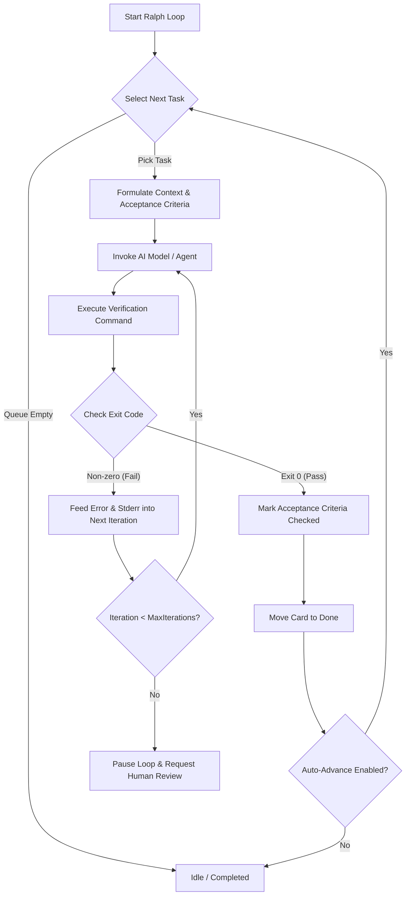

<div align="center">

# ⚡ Antigravity Kanban & Ralph Loop

**Interactive Kanban Board and Autonomous TDD Looping Agent with Multi-Model Intelligence for Antigravity & VS Code**

[](https://github.com/warriorwizard/RalphLoop/actions/workflows/release.yml)
[](https://github.com/warriorwizard/RalphLoop/actions/workflows/ci.yml)
[](LICENSE)
[](https://code.visualstudio.com/)
[](https://github.com/warriorwizard/RalphLoop)

[Features](#-features) • [Ralph Loop Engine](#-autonomous-ralph-looping-engine) • [Model Selection](#-supported-models--providers) • [Installation](#-installation) • [Quick Start](#-quick-start) • [Workflows](#-github-actions-vsix-release-workflow) • [License](#-license)

</div>

---

## 📖 Overview

**Antigravity Kanban & Ralph Loop** turns your workspace into an autonomous AI development engine. It pairs a modern, real-time drag-and-drop Kanban board with **Ralph Loop**—an autonomous test-driven development (TDD) agent engine that continuously picks tasks, formulates prompts, invokes frontier or local models, runs automated verification commands, self-corrects on failures, and advances the project queue until completion.

Designed natively for the **Antigravity Code Editor** and **VS Code**, all task state is synchronized bidirectionally between a machine-readable JSON state machine and Git-versioned Markdown documentation.

---

## ✨ Features

- **🎯 Dual-Format Synchronization (`.antigravity/`):**
  - `.antigravity/kanban.json`: Structured, machine-actionable state machine for AI agents, external tools, and the visual UI.
  - `.antigravity/KANBAN.md`: Human-readable CommonMark documentation formatted with markdown checklists, priorities, and audit logs.
  - **Live Bi-Directional Sync:** Edits made by AI agents (Antigravity, Claude Code, Aider, Cursor) directly to `KANBAN.md` or `kanban.json` reflect instantly on the visual board without reloading.
- **🔄 Autonomous Ralph Looping Engine:**
  - Continuous TDD agent loop that auto-executes tasks, tracks acceptance criteria, runs test suites (`npm test`, `pytest`, `cargo test`, `go test`), self-corrects on failure, and advances through the backlog.
- **🧠 Multi-Model & Local LLM Selection:**
  - **Antigravity Native:** Gemini 3.8 Flash (High/Med/Low), Claude Opus 4.6 (Thinking), Claude Sonnet 4.6 (Thinking), GPT-OSS 120B, Gemini 3.1 Pro, and more.
  - **Frontier APIs:** Anthropic (Claude 3.7 / 3.5 Sonnet), OpenAI (GPT-4o), Google (Gemini 2.0 Flash), DeepSeek (R1 / V3).
  - **Local & Self-Hosted:** Direct integration with Ollama (`http://127.0.0.1:11434`) and custom OpenAI-compatible endpoints (vLLM, LM Studio, OpenRouter).
  - **Terminal Agent:** Dispatches prompts directly into your active integrated terminal.
- **📊 Rich Kanban Workspace Views:**
  - **Full Webview Board (`Ctrl+Alt+K` / `Cmd+Alt+K`):** HTML5 drag-and-drop board across configurable stages (*Queue / Pending, Running / In Progress, Completed / Done*).
  - **Activity Bar Sidebar:** Quick status counters, active task indicator, and one-click Ralph actions.
  - **Status Bar Indicator:** Real-time indicator displaying active task ID and loop status (`Ralph Idle`, `Ralph: [TASK-001]`, `Ralph: Verifying...`).
  - **Live Telemetry Drawer:** Real-time monospace streaming log of model reasoning, tool invocations, and test outputs.
- **🏷️ Rich Task Metadata:**
  - Support for **Features / Epics**, **Sub-stories**, **Acceptance Criteria**, **Item Types** (*Story, Task, Bug, Feature*), and **Priorities** (*Urgent, High, Medium, Low*).
  - Individual verification commands per card or sub-story.
- **📁 Multi-Project Workspace Switcher:**
  - Seamlessly switch active Kanban boards when working inside multi-root workspaces or monorepos.

---

## 🔄 Autonomous Ralph Looping Engine

The **Ralph Loop** brings autonomous Test-Driven Development (TDD) to life:



### Ralph Loop Execution Modes

| Execution Mode | Description |
|---|---|
| **Planning** | Analyzes workspace, decomposes objectives, writes sub-stories and verification plans before code modification. |
| **Fast** | Direct prompt execution without intermediate reasoning phases for fast prototyping and straightforward tasks. |
| **Pseudo-Ralph** | Simulates full Ralph loop iterations with dry-run verification for pipeline testing. |
| **Antigravity Native** | Utilizes the built-in Antigravity Code Editor model and tool execution runtime. |
| **Direct API** | Directly connects to external LLM APIs (Anthropic, OpenAI, DeepSeek, Google AI Studio, Ollama). |
| **Terminal Agent** | Routes prompts to your interactive CLI agent running in the VS Code terminal. |

---

## 🧠 Supported Models & Providers

Ralph Loop offers a comprehensive model selection directly accessible from the Kanban header:

### 1. Antigravity Native Models
- `Gemini 3.8 Flash (High)` *(Default)* — Flagship high-reasoning model
- `Gemini 3.8 Flash (Medium / Low / Flash)` — Low-latency streaming models
- `Claude Opus 4.6 (Thinking)` — Deep architectural reasoning agent
- `Claude Sonnet 4.6 (Thinking)` — Fast coding & thinking agent
- `Claude 4.5 Sonnet / Opus` — Complex refactoring models
- `Gemini 3.1 Pro (High / Low)` — Extended context reasoning
- `GPT-OSS 120B (Medium)` — Native open-weights reasoning model

### 2. External Cloud APIs
- **Anthropic:** `claude-3-7-sonnet`, `claude-3-5-sonnet`
- **OpenAI:** `gpt-4o`
- **DeepSeek:** `deepseek-r1`, `deepseek-v3`
- **Google AI Studio:** `gemini-2.0-flash`, `gemini-2.0-pro`

### 3. Local & Custom Endpoints
- **Ollama:** `ollama-local` (Default endpoint: `http://127.0.0.1:11434`)
- **Custom OpenAI-Compatible:** Configurable base URL for vLLM, LM Studio, or OpenRouter
- **Terminal CLI:** `terminal-agent` for CLI-based assistants (Aider, Claude Code, Goose)

---

## 🚀 Installation

### Option 1: Install from GitHub Release (.vsix)

1. Download the latest `RalphLoop-*.vsix` or `antigravity-kanban-*.vsix` from the [Releases](https://github.com/warriorwizard/RalphLoop/releases) page.
2. In your terminal:
   ```bash
   code --install-extension RalphLoop-1.0.0.vsix
   ```
   *Or inside Antigravity / VS Code:*
   - Press `Ctrl+Shift+P` (`Cmd+Shift+P` on macOS).
   - Select **Extensions: Install from VSIX...**
   - Choose the downloaded `.vsix` file.

### Option 2: Build and Install from Source

```bash
# Clone the repository
git clone https://github.com/warriorwizard/RalphLoop.git
cd RalphLoop

# Install dependencies
npm ci

# Compile extension
npm run compile

# Package VSIX
npm run package

# Install into VS Code / Antigravity
code --install-extension antigravity-kanban-1.0.0.vsix
```

---

## ⚡ Quick Start

1. **Open the Kanban Board:**
   - Press `Ctrl+Alt+K` (or `Cmd+Alt+K` on macOS), or click the **Antigravity Kanban** icon in the Activity Bar.
2. **Create a Task:**
   - Click **+ New Task** or press `Ctrl+Shift+P` -> `Antigravity Kanban: Add Task`.
   - Provide a title, description, priority, acceptance criteria, and an automated verification command (e.g., `npm test`).
3. **Configure Settings & API Keys:**
   - Click **⚙ Settings** on the board.
   - Enter your API keys (securely stored in VS Code's encrypted `SecretStorage`) or configure your local Ollama endpoint.
4. **Start the Ralph Loop:**
   - Click **▶ Start Ralph Loop** in the top bar or sidebar.
   - Monitor live progress in the status bar and bottom telemetry console.

---

## ⌨️ Commands & Keybindings

| Command | Keybinding | Description |
|---|---|---|
| `Antigravity Kanban: Open Board` | `Ctrl+Alt+K` / `Cmd+Alt+K` | Opens the full interactive Kanban board |
| `Antigravity Kanban: Start Ralph Loop` | — | Starts autonomous execution loop |
| `Antigravity Kanban: Pause Ralph Loop` | — | Pauses active loop execution |
| `Antigravity Kanban: Stop Ralph Loop` | — | Stops loop cleanly |
| `Antigravity Kanban: Add Task to Board` | — | Quick input to add a new task |
| `Antigravity Kanban: Reload from Disk` | — | Forces re-sync from `.antigravity/` files |

---

## ⚙️ Configuration Reference

Configure settings in `.vscode/settings.json` or through the Settings UI (`Ctrl+,`):

```json
{
  "antigravityKanban.defaultModel": "Gemini 3.8 Flash (High)",
  "antigravityKanban.executionMode": "Planning",
  "antigravityKanban.maxIterations": 5,
  "antigravityKanban.defaultVerificationCommand": "npm test",
  "antigravityKanban.autoAdvance": true,
  "antigravityKanban.ollamaEndpoint": "http://127.0.0.1:11434",
  "antigravityKanban.customApiEndpoint": "https://api.deepseek.com/v1"
}
```

---

## 🚀 GitHub Actions VSIX Release Workflow

This repository includes automated CI and Release workflows:

- **Automated VSIX Releases on Tags:**
  Create and push a git tag to trigger an automatic `.vsix` build and GitHub Release publication:
  ```bash
  git tag v1.0.0
  git push origin v1.0.0
  ```
- **Manual Workflow Dispatch:**
  Trigger a release build directly from the GitHub Actions tab via `workflow_dispatch`.

---

## 📚 Documentation

For an in-depth operational guide, configuration manual, and troubleshooting steps, refer to [INSTRUCTIONS.md](INSTRUCTIONS.md).

---

## 📄 License

Licensed under the [MIT License](LICENSE).  
Copyright (c) 2026 warriorwizard / Proxomind Labs.
